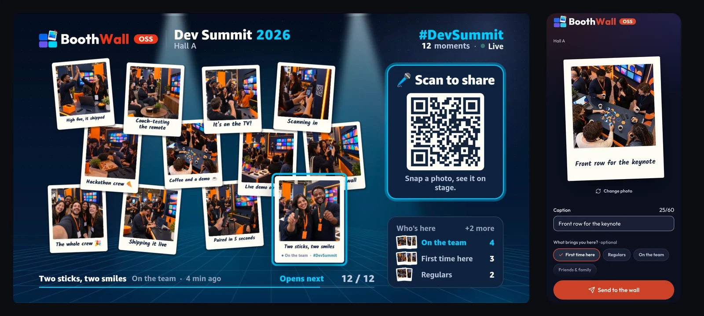
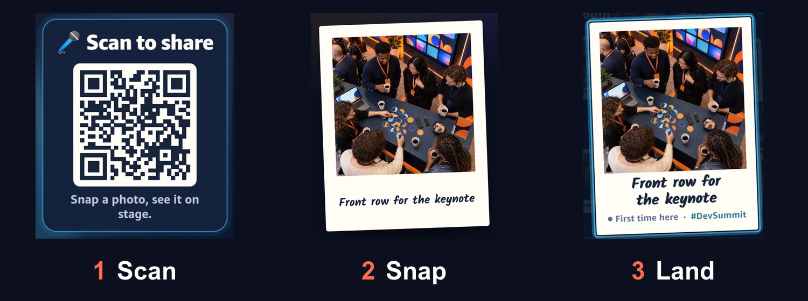
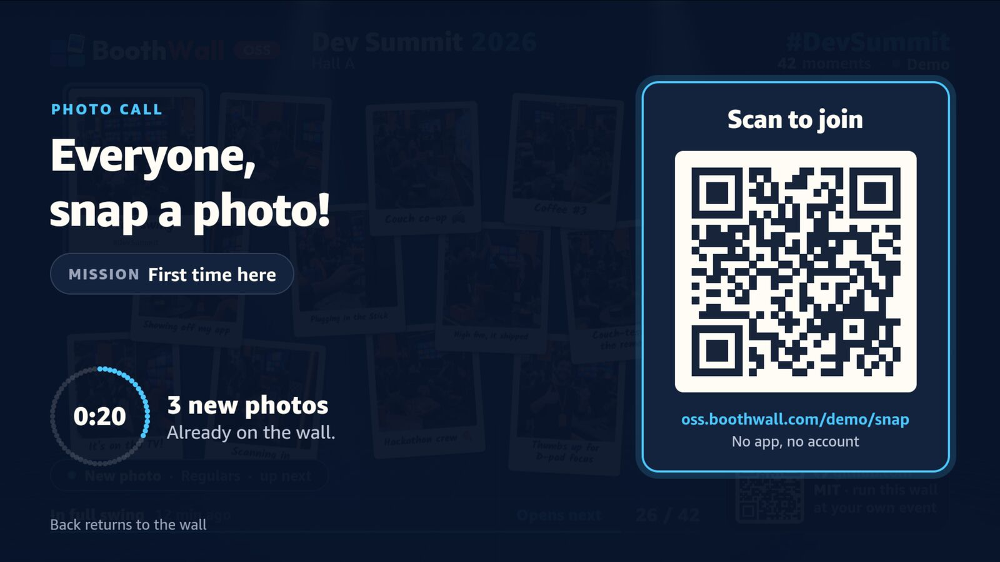
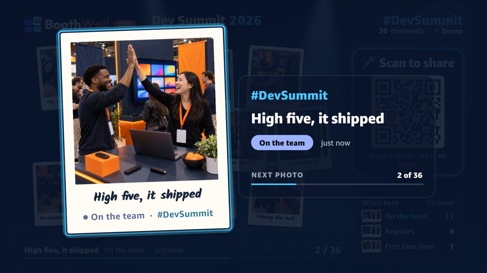
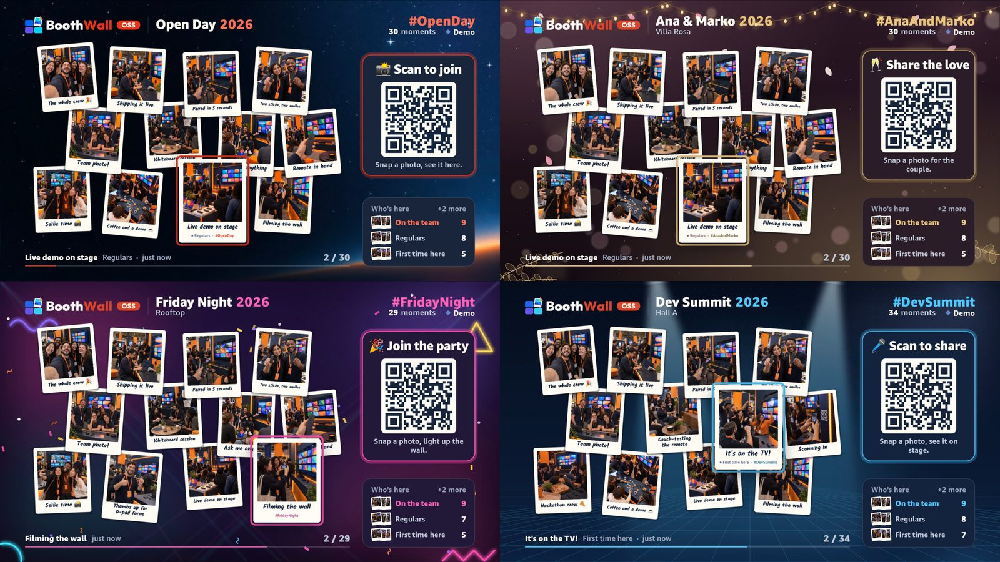
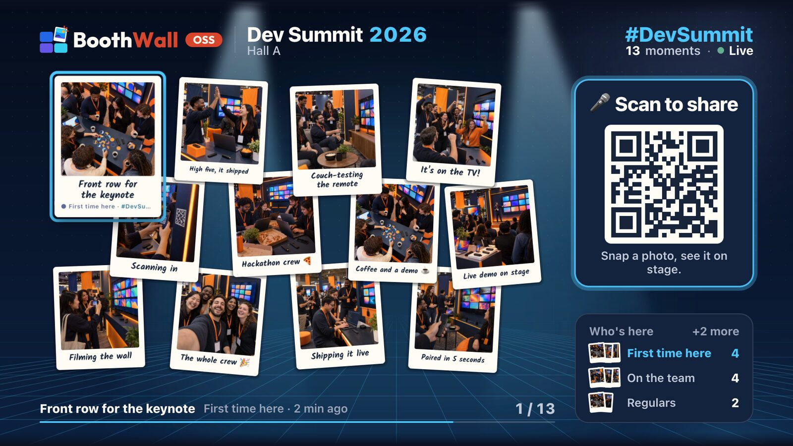

<h1>
  
  
</h1>

**Your moment on the big screen.** A live photo wall for any event: guests send photos from their phones, it plays on Fire TV.

A conference booth, a trade fair, a wedding or a party: guests scan the QR code on the screen, take a photo, a host approves it, and a second later it drops onto the wall as a polaroid. It was built for Fire TV on Amazon Vega OS, and the same wall runs in any browser, so a laptop or a projector works too.

**Runs on** Vega OS (Fire TV) · any browser

**Try it:** [live demo](https://oss.boothwall.com/demo/) · [site and guides](https://oss.boothwall.com)

On the live demo a person approves each photo by hand, so yours may take a while to appear. To approve your own, run it on your machine with `pnpm demo` ([below](#try-it)).

[](https://github.com/boothwall/boothwall-oss/actions/workflows/ci.yml)
[](https://github.com/boothwall/boothwall-oss/releases)


[](LICENSE)





**1. Scan** the QR code on the screen → **2. Snap** a photo and add a caption → **3. Watch it land** on the wall once a host approves it

[Make it yours](#make-it-yours) · [Vega OS field notes](docs/vega-os-notes.md) · [How it's built](docs/architecture.md)

**Rather not run servers?** BoothWall Cloud, the hosted version, is coming soon: [get notified](https://boothwall.com). This repo is the complete open edition.

## Standalone edition

One deployed stack runs one wall for a single host. Configure its identity, branding and presentation in files. The native TV app supports Vega OS only. The browser provides the display at `/`, guest capture at `/snap`, and a passcode-protected Control desk at `/control` (Review, Live and Guests tabs on a phone).

## What you get

### A TV app built for Vega OS

Twelve polaroids drift on the wall, a page at a time, while it steps through every approved photo. New arrivals get a badge and a moment full screen. The side panel has the QR code and a live count per category. It's driven by the D-pad, Back is kiosk-safe, and every animation runs on the native driver.

The room can drive it too. The remote's Play/Pause and Next/Previous keys reach the wall through Vega Media Controls, the route Alexa's "pause" and "next" take too. Hold OK, or press **Photo call** in Control, for a **photo call**: a minute with a big QR code, a mission from your categories and a countdown, then a closing card with the photos it brought. Outside demo mode Menu opens a card naming every remote button, and so does **Remote help** in Control; any key closes it, or it goes after ten seconds. Control's **Photo call** and **Remote help** reach the browser wall too: there Escape ends a call, and a key or a click closes the card.





Press OK for the spotlight, a full-screen slideshow that keeps going on its own.



Four looks come with it, each one line in the config (`settings.theme`): universal, wedding, party and conference. In demo mode the remote's Menu button flips through them, and **Next theme** in Control flips the TV and browser walls through them until the app restarts or the page reloads.

### The same wall in a browser



The wall is one shared package. The TV renders it through React Native for Vega and the web app renders the same code through React Native for Web, live from the same API. Open the wall in a browser and put it on a projector, or press F for full screen.

The root address stays a display on every screen size. Guests use the separate `/snap` page; changing the browser width never changes its role.

### A phone page and a Control desk

Guests upload at `/snap`, the address behind the QR code. They pick a photo, add a caption, choose a category when required, and tick the consent box. The page then follows their photo: it tells them the moment it's live, says "Still waiting · the host reviews each photo" if nobody has approved it after 15 seconds, and says "Not this time. The host didn't put this one on the wall." if the host keeps it off, with a button to send another. While it's waiting or live, they can remove it themselves. The page speaks English and German.

Manual approval is the default. Control is the host's desk: today's numbers (on the wall, waiting, sent today) and the waiting queue to approve or reject, a live preview of the wall, switches for the slideshow and guest uploads, **Photo call**, **Remote help** and **Next theme** for the TV and the browser wall, and the guest QR and link. On a phone it splits into Review, Live and Guests at `/control`, `/control/live` and `/control/guests`. Branding, categories and presentation are configured in files, not in Control.

### A small Cloudflare backend

A Hono API on Cloudflare Workers, photos in R2, rows in D1, and one Durable Object that pushes each approval to every screen. It hibernates while nothing is happening, so a connected screen sitting idle costs nothing.

## Try it

Tested on macOS on Apple Silicon with Node 24, pnpm 10 and Vega SDK 0.24.12112.

### On your machine, in one command

You need Node 24 and pnpm 10 (`corepack enable` sets up pnpm); no Vega SDK and no Cloudflare account:

```sh
git clone https://github.com/boothwall/boothwall-oss && cd boothwall-oss
pnpm install
pnpm demo --lan
```

The launcher times each startup step, then shows a card with the guest link, the host Control
link and passcode, and the wall link. In a supported terminal, LAN mode puts a QR code for the
guest link beside them, follows new uploads and approvals live, and takes single keys: `w`
opens the wall, `c` Control, `s` the guest page, `p` copies the passcode, `q` stops. Narrow
terminals stack the QR; redirected output, CI and `NO_COLOR` keep the full links without the
QR, shortcuts or decoration.

It starts the API and web app on your machine's network address, adds approved demo photos to a fresh wall and prints display, guest and Control addresses plus the local passcode. Open `/` on a laptop or projector, scan its QR code with your phone, send a photo and approve it in `/control`. Your phone needs to be on the same network. Plain `pnpm demo` keeps everything on localhost, where `/snap` in a second browser tab stands in for the phone. Ctrl+C stops it.

`pnpm web:dev` runs the web app alone against the API in your config, at http://localhost:5173. Arrow keys, Enter, Space and Escape stand in for the remote. Add `?demo` to run the wall on the bundled photos with no API at all, `?kiosk` to hide the cursor and hints, or `?fullscreen` to go full screen on the first key press.

### On the Vega Virtual Device

You need the [Vega SDK](https://developer.amazon.com/docs/vega/0.24/install-vega-sdk.html) with the Virtual Device, Node 24 and pnpm 10. Start the Virtual Device, then run the whole thing:

```sh
export PATH="$HOME/vega/bin:$PATH"
pnpm tv:vvd:start:1080   # the Virtual Device at 1920×1080
pnpm try
```

`pnpm try` is `pnpm demo --lan` plus the TV: it points `urls` in the config at your machine while it runs (the TV reads its API at build time; stopping puts the config back), builds the app and opens it on the Virtual Device. The QR code on the TV leads phones to your local wall. To do it by hand, set the `urls` that `pnpm demo --lan` prints and run `pnpm tv:build:debug && pnpm tv:run:vvd` (`tv:run:vvd` installs the Apple Silicon build; on an Intel Mac use `pnpm try`).

Use the Virtual Device's on-screen remote, or run `pnpm remote` for a bigger one in your browser. To run without a network, set `demo: true` in the config and rebuild; in demo mode the remote's Menu button steps through the four themes.

## Make it yours

For developers: about 15 minutes to your own wall on Cloudflare's free tier. Photos go to R2, and Cloudflare asks for a payment method before it turns R2 on, even on the free tier.

1. **Configure.** Everything event-specific lives in [`packages/shared/src/config/boothwall.config.ts`](packages/shared/src/config/boothwall.config.ts): the event name, hashtag, categories, brand colours, the badge beside the logo and where it deploys. Set `deploy.apiDomain` and `deploy.webDomain` to domains on your Cloudflare account, or to `""` for free workers.dev addresses. [docs/customising.md](docs/customising.md) explains every field.
2. **Brand it.** Swap the logo, the TV backdrop and the icons for yours, keeping the file names ([list](docs/customising.md#brand-images)). To see a fully branded wall first, run `pnpm boothwall example conference-booth`.
3. **Deploy.** Run `pnpm exec cf auth login`, then `pnpm boothwall setup`. Unless `apps/api/.dev.vars` already has a Control passcode, it asks for one of 12 or more characters (Enter makes one) and keeps it there. Then it creates the D1 database and R2 bucket in your account, deploys the API and the web app, and writes the addresses back into the config. It doesn't print a passcode it made; read it from that file. After that, `pnpm boothwall deploy` ships changes.

   If you ran `pnpm demo` first, `apps/api/.dev.vars` already holds the demo's 8-digit passcode, and setup stops before it creates anything rather than replace it. Change the `ADMIN_TOKEN=` line to 12 or more characters (letters, digits and `_ ! @ % + = : . , / -`), or delete the line to be asked, then run setup again. `pnpm demo` keeps using whatever passcode is there.

4. **Put it on the TV.** Set `tv.wallId` in the config (and `tv.displayCredential` only if your host checks one), then build a release and install it on a Fire TV in developer mode, or on the Virtual Device. The build is yours: it shows that one wall, a different wall means a rebuild, and the config inside it can be extracted, so keep it on your own TVs and never publish the `.vpkg` ([details](docs/customising.md#your-own-tv-build)).

   ```sh
   pnpm tv:build:release
   vega run-app apps/tv-vega/build/armv7-release/tv_armv7.vpkg com.boothwall.app.main -d <device>
   ```

   `<device>` is the stick's serial from `vega device list`. The first time, the stick needs developer mode, which takes an Amazon developer account (free to create): [Turning on developer mode on a Vega OS Fire TV Stick](https://oss.boothwall.com/blog/fire-tv-vega-developer-mode) walks through it, and [Testing a Vega app on a real Fire TV Stick](https://oss.boothwall.com/blog/testing-vega-on-a-fire-tv-stick) covers connecting over Wi-Fi, installing, pressing keys and taking screenshots from a terminal. After a fresh install, the remote's Play/Pause and Next/Previous keys work from the app's second launch. To update the TV, rebuild and run the same command; the config is bundled into the app, so the TV keeps the old values until you do.

## Troubleshooting

- **A phone can't open the `--lan` address.** It has to be on the same network as your machine, and some Wi-Fi networks (guest networks, many offices and venues) keep devices apart. If macOS asks whether Node may accept incoming connections, allow it; a VPN can get in the way too. Without a phone, plain `pnpm demo` and `/snap` in a second browser tab work.
- **The Virtual Device can't reach your machine.** Use `pnpm try` or `pnpm demo --lan`, which listen on every interface; a server that listens only on `localhost` is out of the Virtual Device's reach. More in the [Vega OS notes](docs/vega-os-notes.md#debugging).
- **"Package is invalid" on install.** Check the manifest: an ASCII `title` and the icon with its file extension ([details](docs/vega-os-notes.md#the-manifest)). Install the `.vpkg` built for that device: `armv7` for a Fire TV Stick, `aarch64` for the Virtual Device on Apple Silicon.
- **An Intel Mac.** `pnpm tv:run:vvd` installs the Apple Silicon build. Use `pnpm try`, which picks the right one, or run `vega run-app` on `apps/tv-vega/build/x86_64-debug/tv_x86_64.vpkg`.
- **The TV app never shows a wall.** A fresh clone's config points at an example API, `https://wall-api.example.com`, and the TV reads it at build time. Run `pnpm try`, run `pnpm boothwall setup`, or set `demo: true`, then rebuild.

## Learn more

- [Running an event](docs/running-an-event.md): the TV remote, the Control desk, what guests see after sending, and privacy and safety.
- [Older review settings](docs/smart-moderation.md): upgrading a saved instance to manual standalone approval.
- [Customising](docs/customising.md): every config field and the images to replace.
- [How it's built](docs/architecture.md): how a photo gets from a phone to the wall, and why each piece is the way it is.
- [Vega OS field notes](docs/vega-os-notes.md): the platform gotchas I hit, from build commands to memory on a Fire TV Stick.
- [Development](docs/development.md): commands, running the API locally and changing the database.
- [Changelog](CHANGELOG.md): what changed in each release.
- [Contributing](CONTRIBUTING.md): checks before a pull request and how the code is organised. Issues and pull requests are welcome, especially from people building for Vega OS.

## History

BoothWall started as a booth demo I built on my own and first showed at next.app devCon 2026 in Berlin. Everything event-specific now lives in one config file, so the same code works for any event. The [changelog](CHANGELOG.md) has the rest.

## License

The code is [MIT](LICENSE). The default BoothWall artwork in `brand/` and the apps' asset folders is MIT too, with two exceptions:

- The caption fonts in `apps/tv-vega/assets/fonts/` keep their own licences, the SIL Open Font License 1.1 or Apache 2.0, in the licence file beside each font. The web app loads the same fonts from their `@fontsource` packages.
- The GitHub mark in `packages/wall-ui/src/assets/icons/` belongs to GitHub, Inc. and is used only to link to the repo.

The demo photos, the booth photos in the UI kit's preview and the night-sky backdrop were made with ChatGPT image generation. They show no real people or events.

The TV app builds on the Vega SDK and the `@amazon-devices/*` packages, which come from npm under Amazon's [Program Materials License Agreement](https://developer.amazon.com/support/legal/pml), not MIT. They aren't in this repo, but a built `.vpkg` contains them.

BoothWall is an independent project by [@ddedic](https://github.com/ddedic). It isn't an official Amazon product and isn't endorsed by Amazon. Amazon, Fire TV, Vega and Alexa are trademarks of Amazon.com, Inc. or its affiliates. GitHub and the GitHub logo are trademarks of GitHub, Inc.
